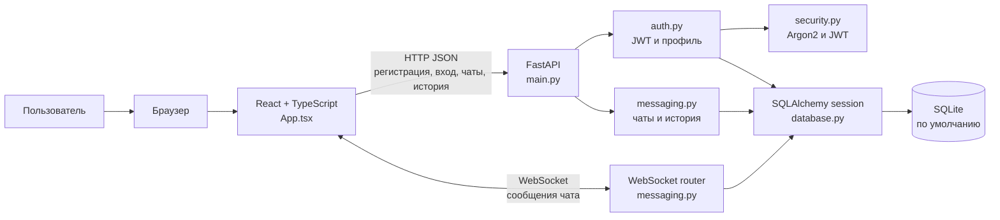
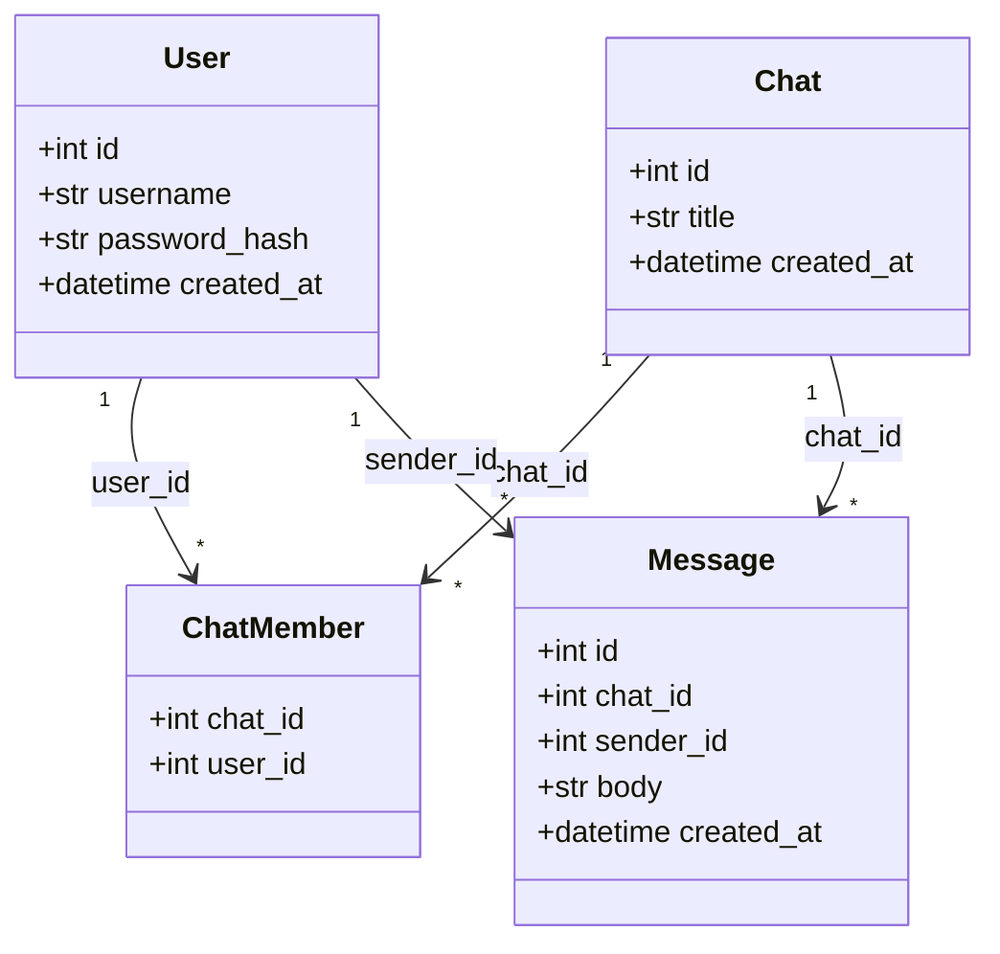
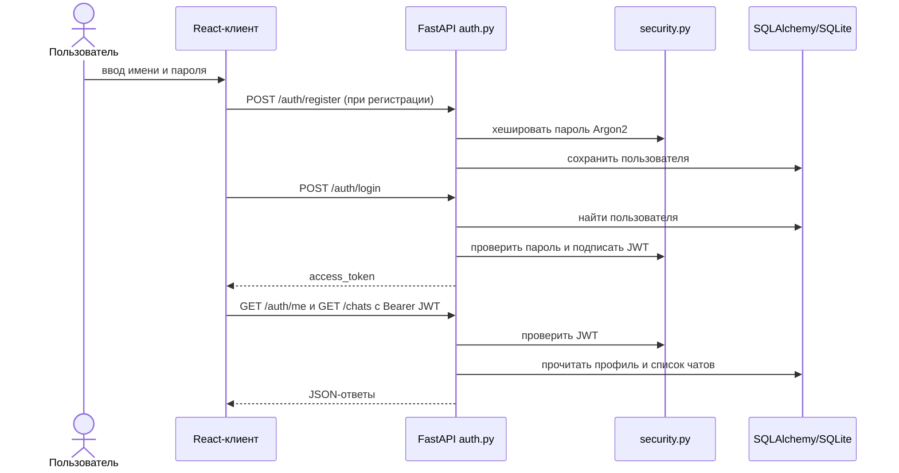
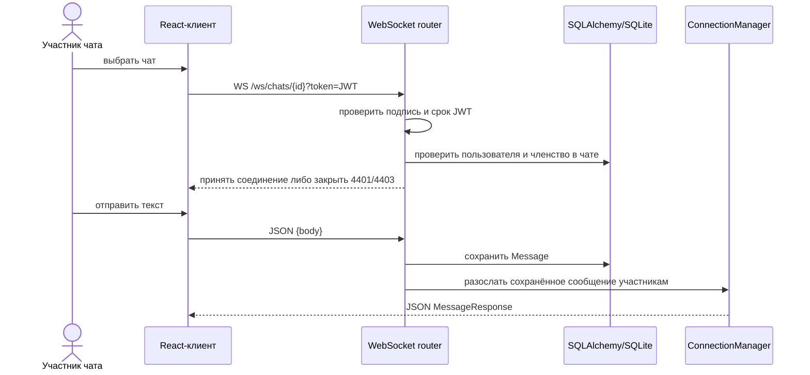

# Архитектура мессенджера

Проект разделён на браузерный клиент и HTTP API. Клиент написан на React и TypeScript; API реализован на FastAPI. Оба модуля обмениваются JSON по HTTP, а сообщения чата передаются по WebSocket. Слой доступа к данным использует SQLAlchemy; локально по умолчанию применяется SQLite. Подключение PostgreSQL поддерживается через `DATABASE_URL`, но в этой версии не проверялось.

Схема архитектуры подготовлена как [architecture.png](architecture.png). Связи классов и последовательности запросов ниже приведены в Mermaid-формате.

## Модули и границы ответственности

| Модуль | Ответственность |
|---|---|
| `frontend/client/src/App.tsx` | Формы входа и регистрации, список чатов, история и WebSocket-клиент |
| `backend/app/main.py` | Создание FastAPI-приложения, CORS, подключение маршрутизаторов, системные маршруты |
| `backend/app/auth.py` | Регистрация, вход, получение профиля и проверка текущего пользователя |
| `backend/app/messaging.py` | Создание чатов, проверка членства, история, соединения и рассылка сообщений |
| `backend/app/schemas.py` | Валидация и сериализация запросов/ответов на Pydantic |
| `backend/app/models.py` | ORM-модели `User`, `Chat`, `ChatMember`, `Message` |
| `backend/app/database.py` | Настройка SQLAlchemy Engine и фабрики сессий из `DATABASE_URL` |
| `backend/app/security.py` | Хеширование Argon2 и создание/проверка JWT |

## Связи данных

Поля с `+` перечислены как публичные поля ORM-моделей. Отдельных приватных полей или схем наследования между бизнес-моделями в текущей реализации нет. Связь пользователя с чатом реализована таблицей `ChatMember` с составным первичным ключом.

## Основные потоки

WebSocket-соединения хранятся в памяти одного процесса. Сообщение сохраняется до рассылки; проверка членства выполняется при соединении. Аутентификация WebSocket использует JWT из query-параметра.
